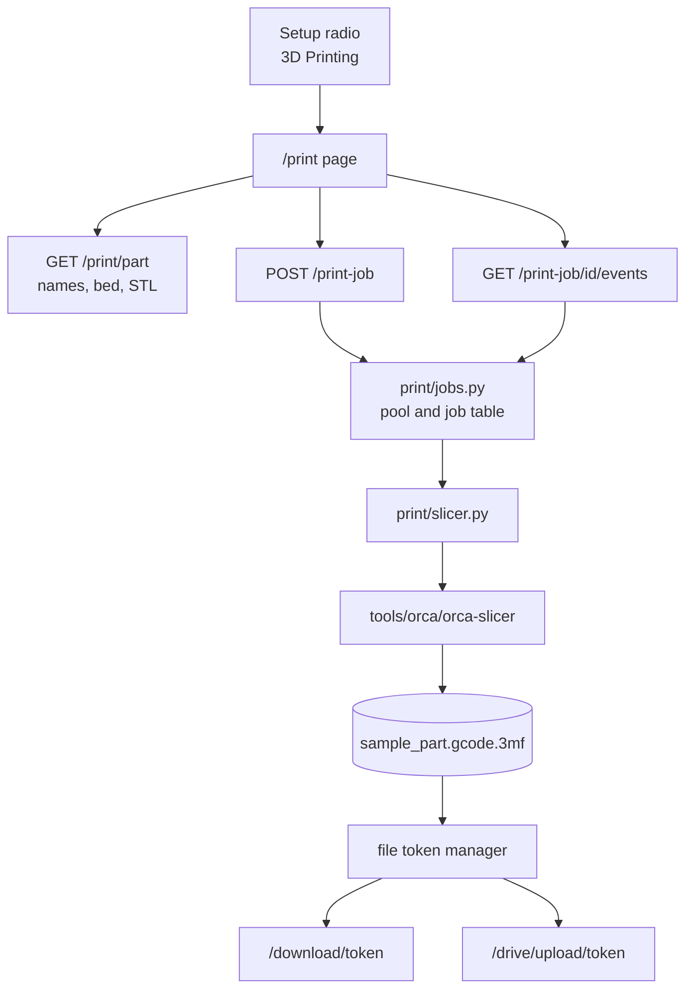

# 3D Printing: the print path (stage 1)

Developer guide for PenguinCAM's 3D print path.
Deployment numbers live in [DEPLOYMENT_GUIDE.md](DEPLOYMENT_GUIDE.md). The fixed assets
are described in [print/README.md](../print/README.md).

## 1. What stage 1 does

Stage 1 proves the slicing pipeline end to end. It slices one part, with one profile
set, through Orca Slicer's command line, on a wizard page of its own.

- **One fixed part.** `print/sample_part.stl`, an L bracket of 40 x 30 x 12 mm. Nothing
  is exported from Onshape yet.
- **One fixed profile set.** Three flattened Bambu Lab profiles in `print/profiles/`.
  Team configuration does not choose them yet.
- **Orca Slicer's command line.** A pinned release at a fixed path, run headless as a
  subprocess. No GUI, no display server.
- **A separate wizard page.** `/print` has the same look as the CNC wizard and none of
  its code. It shares the stylesheet, the session gate, the file token manager, the
  download route and the Drive route.

The student picks 3D Printing on the Setup screen, walks Setup, Parts, Layout and
Preview, and saves `sample_part.gcode.3mf`.

## 2. Architecture



### Where the files live

Everything the print path owns sits under the top-level `print/` directory, so a future
fabrication technology can take its own directory beside it. Five things outside it know
the print path exists:

- the `init_print_routes(...)` and `init_printer_routes(...)` calls in
  `frc_cam_gui_app.py`, which also reads `printer_enabled` for the wizard's bootstrap;
- the "3D Printing" radio in `templates/wizard.html`;
- its handler in `static/wizard.js`;
- `team_config.py`, for the `pairing_code` property;
- `config_validation.py`, for the same key.

The last two import `normalize_code` from `print.printer_relay`, because a pairing code is
printer vocabulary and hoisting the helper to a root module would put printer knowledge in
the CNC configuration layer. The cost is a real constraint, and it is deliberate:
**`print/` is a hard dependency of the CNC configuration path**, so the directory can no
longer be removed without breaking `team_config.py` and everything that reads a team's
YAML. What keeps that cheap is that `normalize_code` is a pure function and
`print/__init__.py` is a docstring and nothing else, so the import runs no code.

```
print/
  __init__.py          the package docstring and the import caveat below
  routes.py            the Flask blueprint
  jobs.py              the pool and the job table, no Flask
  slicer.py            the Orca wrapper, no Flask
  printer_relay.py     the printer relay's in-memory records and tokens, no Flask
  printer_routes.py    the printer relay's Flask blueprint
  printer_daemon/      the Raspberry Pi daemon, its own requirements.txt and installer
  templates/           print_wizard.html
  static/              print_wizard.js, print_viewer.js, printer_panel.js
  scripts/             install-orca.sh, make_sample_part.py, flatten_orca_profiles.py
  tests/               the Python tests, tests/js/ and tests/printer_panel/ for node
  profiles/            the flattened Bambu Lab profiles
  sample_part.stl      the fixed part
```

The printer relay and the daemon are documented on their own, in
[PRINTER_SETUP.md](PRINTER_SETUP.md). They sit here because they are part of the printing
path; the daemon is never imported by the backend and never imports it.

Orca itself still installs to `tools/orca/` at the repository root, not under `print/`:
it is a large untracked build artifact, `.gitignore` and `.dockerignore` name that path,
and the Dockerfile's layer caching depends on it.

`print` is a valid package name in Python 3 but it is also the name of a builtin, so
**never write a bare `import print`** - that binds `print` in the importing module and
shadows the builtin function there. `from print import jobs` and
`from print.routes import init_print_routes` are safe and are what the code uses.
`print/tests/test_layout.py` fails the build if a bare import appears.

`print/routes.py` holds the blueprint. `print/jobs.py` holds the pool and the job table
and imports no Flask. `print/slicer.py` runs Orca and imports no Flask.
`frc_cam_gui_app.py` calls `init_print_routes(...)` once near the end of the file, after
the limiter and the temp folders exist, and hands over the session gate, the token
manager, the limiter, the upload and output folders, the template context, metrics and
the log function. `print/routes.py` never imports `frc_cam_gui_app`, so there is no
import cycle.

## 3. Orca Slicer, the fixed location

Orca is a core dependency, like the Python interpreter. It is never optional and never
configurable.

### The fixed path

The entry point is always `tools/orca/orca-slicer`, relative to the repository root.
`print/slicer.py` computes that path from its own file location. There is no environment
variable and no lookup on `PATH`.

### The install script

`print/scripts/install-orca.sh` is the only place the version and the checksums live. It pins
`ORCA_VERSION=2.4.2` and one SHA-256 per platform, and downloads from
`github.com/OrcaSlicer/OrcaSlicer`.

| Platform | `uname -s` / `uname -m` | Asset |
|----------|--------------------------|-------|
| Railway production, CI | Linux / x86_64 | `OrcaSlicer_Linux_AppImage_Ubuntu2404_V2.4.2.AppImage` |
| aarch64 Linux, Docker on Apple silicon | Linux / aarch64 | `OrcaSlicer_Linux_AppImage_Ubuntu2404_aarch64_V2.4.2.AppImage` |
| macOS development | Darwin / arm64 | `OrcaSlicer_Mac_universal_V2.4.2.dmg` |

Any other combination is refused with a message naming both values. A checksum mismatch
deletes the download and exits non-zero. The script is idempotent: if
`tools/orca/VERSION` already reads `<version> <arch>` and the wrapper is executable, it
exits without touching the network. The stamp carries the architecture, so a `tools/`
directory copied from macOS into a Linux build is detected and replaced, not trusted.
Anything already at `tools/orca` that does not match is deleted before the download.

### The Linux wrapper

On Linux the AppImage is extracted with `--appimage-extract`, so no FUSE is needed, and
the script writes `tools/orca/orca-slicer` as a shell wrapper. The wrapper does not use
the AppImage's `AppRun`. AppRun execs `libexec/orca-slicer-env`, and that launcher probes
`ldconfig -p` and `/usr/lib` for the host's OpenGL and WebKit libraries, which fails in a
container without those packages. The wrapper sets what `AppRun` would set and execs the
binary directly:

- `APPDIR` pointing at `squashfs-root`.
- `LC_ALL=C`.
- `LD_LIBRARY_PATH` of `squashfs-root/lib/orca-runtime` and `squashfs-root/bin`, plus
  `tools/orca/hostlibs/usr/lib/<triplet>` and its `gstreamer-1.0` subdirectory when that
  directory exists.

All arguments pass through. On macOS the script mounts the disk image, copies
`OrcaSlicer.app` into `tools/orca/`, clears `com.apple.quarantine` with `xattr -dr`, and
writes the same style of wrapper pointing at `Contents/MacOS/OrcaSlicer`.

Either way the script finishes with a smoke test: it runs `orca-slicer --help` inside a
scratch directory and deletes it, because Orca drops a `result.json` in the working
directory on every run, `--help` included. Only then is `tools/orca/VERSION` written.

### The unprivileged `hostlibs` path

The AppImage bundles a handful of private libraries and takes the rest from the host.
After extraction the script runs `ldd` against the binary and every host library it has
unpacked so far, and collects the sonames that do not resolve. If nothing is missing it
stops there.

If libraries are missing and the script runs as root, it fails and tells the operator to
install the distro packages. If it is not root, it bootstraps them:

1. Fetch the Ubuntu noble `Contents-<arch>.gz` index and the `main` and `universe`
   `Packages.gz` files from the archive mirror for the architecture.
2. Map each missing soname to the package that ships `usr/lib/<triplet>/<soname>`,
   ignoring `-dev` and debug packages.
3. Read that package's pool filename and SHA-256 from the `Packages` index, download it,
   verify the checksum, and unpack it with `dpkg-deb -x` into `tools/orca/hostlibs/`.
4. Repeat the `ldd` check, up to twelve rounds, and fail if a round makes no progress.

The wrapper picks `hostlibs` up automatically. `dpkg-deb` is required for this path. In
the Docker image the distro packages are present, `ldd` is clean on the first pass, and
`hostlibs` is never created.

### The Docker image

The Dockerfile pins `python:3.11-slim-trixie`. The Linux AppImages are built on Ubuntu
24.04 and need glibc 2.38 or newer; Debian 13 has 2.41. The pin stops a future tag move
from changing the C library under Orca.

The image installs `ca-certificates` and `curl` plus Orca's runtime libraries, resolved
from the trixie package index and identical on amd64 and arm64:

```
libopengl0 libegl1 libgl1 libglx0 libglu1-mesa
libgtk-3-0t64 libgdk-pixbuf-2.0-0 libatk1.0-0t64 libcairo2 libcairo-gobject2
libpango-1.0-0 libpangocairo-1.0-0 libpangoft2-1.0-0 libharfbuzz0b libfontconfig1
libglib2.0-0t64 libdbus-1-3
libgstreamer1.0-0 libgstreamer-plugins-base1.0-0
libwebkit2gtk-4.1-0 libjavascriptcoregtk-4.1-0 libsoup-3.0-0 libsecret-1-0
libwayland-client0 libwayland-egl1 libwayland-server0 libxkbcommon0
libx11-6 libxext6 libsm6 libice6
libstdc++6 libexpat1 liblzma5 libmspack0t64 zlib1g
```

The install script runs before the application code is copied, so a code change does not
re-download 130 MB. `tools/` is in `.dockerignore`, so the build's own install survives
the `COPY . .`. The build ends with an `ldd` check on
`tools/orca/squashfs-root/bin/orca-slicer` and fails if anything prints `not found`.

### Commands

```bash
make install        # Python dependencies and Orca
make install-orca   # Orca only; runs print/scripts/install-orca.sh
```

## 4. Profiles

### Why exported profiles do not work

Orca's vendor profiles are inheritance chains. A Bambu printer profile inherits from a
family profile, which inherits from a base, and each file holds only the keys it
overrides. The command line does not resolve `inherits`. It loads exactly the keys in the
files it is given and fills every other key with built-in defaults, silently. Slicing
with an unflattened Bambu printer profile "succeeds" with a 200 mm bed, a filament density of
zero and no weight in the output.

The desktop app's export does not help. It writes a user preset's differences plus the
parent's name, not a resolved file. A printer profile marked `from: User` with no
`inherits` also fails Orca's printer-to-process compatibility check with return code -17.
That is why the flattened files set `from` to `system`.

### `print/scripts/flatten_orca_profiles.py`

The script reads the `BBL` vendor tree inside the installed Orca:
`tools/orca/squashfs-root/resources/profiles/BBL/` on Linux, or the equivalent under
`OrcaSlicer.app/Contents/Resources/` on macOS, and Orca's filament library beside it
(`profiles/OrcaFilamentLibrary/`). Profiles are found by their `name` field through a name
index over both trees (see "The catalog" below), not by file path. For each output file it:

1. Follows `inherits` from the named profile to the root through the name index, refusing
   a loop.
2. Merges the chain child over parent.
3. Sets `inherits` to an empty string and `from` to `system`.
4. Drops `instantiation` and `setting_id`, which only mean something inside Orca's own
   preset database.
5. Writes JSON with `indent=4`, `sort_keys=True`, `ensure_ascii=False` and a trailing
   newline, so the checked-in files compare byte for byte.

| Output | Vendor subdirectory and profile |
|--------|---------------------------------|
| `print/profiles/printer.json` | `machine/Bambu Lab H2S 0.6 nozzle` |
| `print/profiles/filament.json` | `filament/Generic PETG @BBL H2S` |
| `print/profiles/process.json` | `process/0.24mm Balanced Quality @BBL H2S 0.6 nozzle` |

The printer is a **Bambu Lab H2S** with the **0.6 mm High Flow hardened steel** nozzle on a
**Textured PEI Plate**. The nozzle diameter and the hardened steel come from the vendor
machine profile; the High Flow variant and the plate do not, and are covered next.

Regenerate after an Orca upgrade, from the repository root:

```bash
uv run python print/scripts/flatten_orca_profiles.py
```

Orca's `version` key is a vendor profile version, not the application version, and is
not used.

### Nozzle variants: selecting High Flow

The H2S offers two nozzle variants, and the vendor profiles carry both. Every
variant-aware value is an array parallel to the profile's variant array:

```
printer_extruder_variant  = ["Direct Drive Standard", "Direct Drive High Flow"]
nozzle_volume             = ["145",                   "148"]
```

`filament_extruder_variant` and `print_extruder_variant` do the same for the filament and
the process. Orca resolves these at slice time, in `Print::apply`, which calls
`DynamicPrintConfig::update_values_to_printer_extruders`. That asks
`get_index_for_extruder` for the index whose variant string equals
`"<extruder_type> <nozzle_volume_type>"` - here `"Direct Drive High Flow"` - and reduces
every array to that element. `get_index_for_extruder_parameter` in `ParameterUtils.cpp`
is the same lookup for single values.

Nothing in the vendor profiles makes that choice. The machine profile records
`default_nozzle_volume_type: ["Standard"]`, which only the desktop app reads when it
synchronises with a device. The command line reads `nozzle_volume_type`, and when it is
absent falls back to `nvtStandard`, which is index 0. So `flatten_orca_profiles.py`
writes the selection into the machine profile explicitly:

```json
"nozzle_volume_type": ["High Flow"]
```

The arrays are left intact. Collapsing them to their first element would both hide the
choice and hard-code Standard.

For this particular combination only two values actually differ between the variants -
`nozzle_volume` (145 -> 148) and `nozzle_flush_dataset` (1 -> 2), both in the machine
profile. Generic PETG defines the same numbers for both nozzles, so the High Flow
selection does **not** raise the maximum volumetric speed: it stays at the profile's
12 mm3/s, with nozzle temperature 255 C and flow ratio 0.95. A High Flow nozzle does not
by itself license a higher MVS, and the script never invents one. `nozzle_volume` is the
value to watch in the output: it is the one place the resolved index is visible.

### The plate: `curr_bed_type`, not `default_bed_type`

The command line reads `curr_bed_type`, a `coEnum` parsed through `s_keys_map_BedType`,
so the profile carries the plate by name:

```json
"curr_bed_type": "Textured PEI Plate"
```

`GCode.cpp` turns that into the filament's bed temperature key - `btPTE` maps to
`textured_plate_temp` - which is how the 70 C in `M190 S70` is chosen for this PETG.

`default_bed_type` is not a substitute, for two reasons. It is GUI-only: no command line
path reads it. And `Preset::get_default_bed_type` is advertised as accepting "both
numeric and string format" but runs `atoi()` on the value, so a plate *name* parses as 0,
fails the `> 0` test, logs `invalid bed type` and returns `btPEI` - the smooth High Temp
Plate, not the textured one. The script therefore writes `default_bed_type` numerically
(`"4"`, which is `btPTE`), purely so the value is right if a generated 3mf is opened in
the desktop app.

### The two guarding tests

- `print/tests/test_slicer.py` asserts each checked-in profile has an empty `inherits`
  and carries the keys the pipeline depends on: `name`, `printable_area`,
  `printable_height`, `filament_density`, `layer_height`, and `compatible_printers` on
  the process and the filament.
- `print/tests/orca_integration_test.py` re-runs the flattening script against the installed
  Orca and fails if the output differs from the checked-in files, so an Orca upgrade
  forces a regeneration. It also slices the sample part and reads the configuration Orca
  writes back into the G-code, asserting that all three `*_extruder_variant` lines read
  `Direct Drive High Flow`, that `nozzle_volume` is 148 rather than the Standard 145,
  that `curr_bed_type` is the textured plate and that the G-code contains `M190 S70`.
  That is the only check that proves the selection reached Orca rather than only our JSON.
- `print/tests/test_slicer.py` additionally pins the selection in the checked-in files:
  the High Flow variant sits at index 1 in all three profiles, the dual-valued keys are
  not collapsed, and the PETG numbers are the profile's own.

Run the script with `--audit-only` to print the resolved values and the profile each one
came from without writing anything:

```bash
uv run python print/scripts/flatten_orca_profiles.py --audit-only
```

### The catalog

Besides the three defaults, the script writes a **catalog** to `print/profiles/catalog/`:
every profile a team may name in its `printing:` configuration, flattened the same way.
`--no-catalog` writes the defaults only.

**The name index.** Many BBL filaments live in vendor subfolders
(`BBL/filament/AliZ/...`) and inherit from a base in the separate filament library
(`AliZ PLA @base` in `OrcaFilamentLibrary/filament/base/`), so a lookup at
`<kind>/<name>.json` fails. `build_name_index` walks every JSON file under
`BBL/<kind>/` and `OrcaFilamentLibrary/<kind>/`, recursively, and indexes each by its
`name`; `inherits` is resolved through that index. Two files with one name inside one tree
fail the build. About a hundred filament names (for example `Bambu ABS @base`) exist in
both trees, and most of those differ in value. **The BBL tree's copy wins**, because
`BBL.json` registers its own copy of each such profile, so the BBL file is the one Orca
loads for a BBL printer. The build log prints how many library names were shadowed.

**What is flattened.** Every printer in `H2S_PRINTERS` (the H2S with the 0.2, 0.4, 0.6 and
0.8 mm nozzles), with the High Flow and plate selections applied as for the default
printer, and every filament and process from the BBL tree marked
`instantiation: "true"` whose flattened `compatible_printers` names one of those printers.
Library profiles are flattened only as parents, never listed.

**What is skipped or dropped.** A profile whose variant array lacks
`Direct Drive High Flow` is skipped, because every variant-aware value would silently
resolve to the wrong index; the addnorth filaments (27 profiles with Orca 2.4.2) are
skipped for this. A filament or process whose High Flow index differs from a printer's is
dropped for that printer, which extends `check_selection` to every combination. Each
skipped profile and dropped combination is printed in the build log and listed in
`index.json`.

**`index.json`** holds the Orca version and one list per kind:

```json
{
  "orca_version": "2.4.2",
  "printers":  [{"name": "Bambu Lab H2S 0.4 nozzle", "file": "printer/Bambu_Lab_H2S_0.4_nozzle.json"}],
  "filaments": [{"name": "...", "file": "filament/...json", "compatible_printers": ["..."]}],
  "processes": [{"name": "...", "file": "process/...json", "compatible_printers": ["..."]}],
  "skipped":   [{"kind": "filament", "name": "...", "reason": "..."}],
  "dropped":   [{"printer": "...", "kind": "process", "name": "...", "reason": "..."}]
}
```

`compatible_printers` lists only the printers that passed the variant check. A file's stem
is the profile name with every character outside `[A-Za-z0-9._-]` replaced by `_`; two
names with one stem fail the build. With Orca 2.4.2 the catalog holds 4 printers, 136
filaments and 16 processes, about 1.1 MB, and is committed whole.

**Another printer family** is a one-line change: a list beside `H2S_PRINTERS` passed as
`build_catalog(..., printers=...)`.

`CatalogTest` in `print/tests/orca_integration_test.py` rebuilds the catalog from the
installed Orca and fails if any file, or the set of files, differs from the committed one,
and checks that the build's skipped list equals `index.json`'s.

### Team printing configuration

`print/print_config.py` reads the team YAML's `printing:` section (through
`TeamConfig.printing_section()`, which finds it at the root of a v2 file or under the
default machine of a v1 file, as `pairing_code` does) against the catalog:

```yaml
printing:
  pairing_code: ...                 # the printer relay's, unrelated to slicing
  printer: "Bambu Lab H2S 0.4 nozzle"
  filaments:                        # first is the default
    - "Bambu PLA Basic @BBL H2S"
    - "Bambu PETG HF @BBL H2S"
  processes:                        # first is the default
    - "0.20mm Standard @BBL H2S"
    - "0.16mm High Quality @BBL H2S"
  allow_overrides: true             # the default; false hides the four overrides
```

The names are Orca's own profile names, as listed in `index.json`. The rules:

- **No `printer:` key: the default set.** The three files in `print/profiles/` (the
  0.6 mm nozzle, `Generic PETG @BBL H2S`, `0.24mm Balanced Quality @BBL H2S 0.6 nozzle`),
  overrides allowed. The upload mode always prints with the default set, whatever the
  session holds.
- **An unknown printer fails closed.** Setup shows "The team configuration names printer
  '<name>', which PenguinCAM does not know. Ask a mentor to fix printing.printer." and
  slicing is disabled. There is no fallback to the default printer.
- **An unknown or incompatible filament or process is dropped** with a warning shown on
  Setup ("printing.processes names '<name>', which PenguinCAM does not know or which does
  not fit printer '<printer>'; it was left out.") and logged in the `config` event's
  `skipped`. A list that ends empty, or a `filaments` or `processes` that is not a list,
  is an error that disables slicing ("The team configuration lists no filament that fits
  printer '<printer>'. Ask a mentor to fix printing.filaments."), because the default
  filament and process belong to the 0.6 mm nozzle.

Orca profile names are name-derived: when an Orca upgrade renames a profile, the team's
key stops resolving, and the message above names the key to fix.

The catalog's `index.json` is read once per process (`load_catalog()`); it changes only
with a deploy. `POST /print/page` answers the resolved configuration as `config`
(printer, filaments, processes, allow_overrides, warnings, error, skipped, is_default;
never a path) and the override choices as `overrides`, and draws the plate from the
configured printer's `printable_area`. `POST /print-job` with `copies` takes `filament`,
`process` and `overrides`: a name the team does not offer is refused with "Choose a
filament and print settings from the list.", a configuration error is refused with its own
sentence, and the plate check uses the chosen printer's plate. A body without `filament`
or `process` gets the first of each list.

**Student overrides.** With `allow_overrides` true, Setup offers four settings over the
chosen process. Each menu starts at "Profile default", which sends nothing. The server
accepts only these keys and values (numbers as JSON numbers, the rest as strings) and
maps them to Orca process keys:

| Override | Values | Orca keys written |
|---|---|---|
| `infill` | 10, 15, 20, 30, 40, 60, 100 | `sparse_infill_density: "<n>%"` |
| `walls` | 2, 3, 4, 6 | `wall_loops: "<n>"` |
| `supports` | `off`, `on` | `enable_support: "0"`; on: `enable_support: "1"`, `support_type: "tree(auto)"` |
| `brim` | `auto`, `off`, `outer` | `brim_type: "auto_brim"`, `"no_brim"`, `"outer_only"` |

Anything else is a 400 ("These print settings could not be read; choose them from the
lists."), and so is a non-empty `overrides` when the team set `allow_overrides: false`
("Your team does not allow changing print settings."). The worker writes the job's
`process.json` in its scratch directory, the chosen process with the overrides merged
(`write_process_with_overrides`), and slices with it. `TeamProfileSliceTest` in
`print/tests/orca_integration_test.py` slices a box with the 0.4 mm set and all four
overrides and reads them back from the G-code header.

## 5. Sample part

`print/sample_part.stl` is an L bracket, 40 x 30 x 12 mm, a binary STL in millimetres.
`print/scripts/make_sample_part.py` generates it: the polygon (0,0) (40,0) (40,10) (10,10)
(10,30) (0,30) extruded 12 mm in Z, twenty triangles, one closed shell, outward normals.

Each cap is fanned from the reflex vertex (10,10) using only real polygon vertices. That
keeps every cap boundary edge equal to one footprint edge and leaves no T-junction, so
the shell is closed. The generator is deterministic and `print/tests/test_make_sample_part.py`
asserts the checked-in file equals its output byte for byte.

## 6. `print/slicer.py`

Flask-free. Importing the module calls `_require_binary()`, which raises `RuntimeError`
naming `make install` when `tools/orca/orca-slicer` is absent. That import guard is why
every test module that imports the app needs Orca installed, and why CI installs Orca
before `make test`.

### The command line

`build_command(stl_path, output_dir)` resolves both paths to absolute ones first, because
Orca runs with `cwd=output_dir` and would read a relative path against the wrong
directory. The first element is the absolute path of `tools/orca/orca-slicer`, the module
constant `ORCA_BIN`. It returns, verbatim:

```
<repo>/tools/orca/orca-slicer
    --datadir <output_dir>/datadir
    --load-settings "<repo>/print/profiles/printer.json;<repo>/print/profiles/process.json"
    --load-filaments <repo>/print/profiles/filament.json
    --arrange 1
    --slice 0
    --export-3mf <stem>.gcode.3mf
    --outputdir <output_dir>
    <stl_path>
```

`--arrange 1` centres the part on the plate, which matches the Layout drawing. `--slice 0`
slices every plate; the sample has one.

The pinned binary creates one missing level of `--outputdir` itself. It fails when the
parent is missing too: exit code 156, with a `boost::filesystem::create_directory` error.
`slice_stl` creates the directory anyway, because it also runs Orca with `cwd=output_dir`
and the working directory has to exist before the process starts.

### Isolation

The subprocess gets an allowlisted environment, not the server's. Only `PATH`, `HOME`,
`TMPDIR`, `LANG`, `USER` and `LOGNAME` are copied through, so tokens and client secrets
never reach Orca. On top of that `slice_stl` sets:

| Variable or flag | Value |
|------------------|-------|
| `XDG_CONFIG_HOME` | `<output_dir>/xdg-config` |
| `XDG_RUNTIME_DIR` | `<output_dir>/xdg-runtime`, mode 0700 |
| `LC_ALL` | `C` |
| `--datadir` | `<output_dir>/datadir` |

Every per-user write therefore lands in the job's own scratch directory, and two
concurrent slices never share one. Without `XDG_RUNTIME_DIR` Orca prints an `error:` line
on stderr and carries on, which is why stderr text is never used to judge success.

### Success and failure

Success is the exit code plus the presence of the archive. `SliceError` is raised when
the process cannot be started, times out, exits non-zero, leaves no archive, produces
something that is not a zip, or produces an archive with no `Metadata/plate_1.gcode`
entry. It carries two strings: `message`, one sentence fit for the student, and
`details`, the last twenty lines of Orca's output (or the archive listing) for the server
log. On a non-zero exit the exit code leads `details` and the tail is trimmed to nineteen
lines, so `details` stays twenty lines and the code is always visible. `details` never
reaches the browser.

### `SliceResult`

| Field | Source |
|-------|--------|
| `output_path` | `<output_dir>/<stem>.gcode.3mf` |
| `print_time_s` | `Metadata/slice_info.config`, `<metadata key="prediction" value="…"/>`, seconds |
| `filament_g` | same file, `<metadata key="weight" value="…"/>`, grams |
| `filament_m` | same file, the `used_m` attribute of the `<filament>` element |
| `layer_count` | `Metadata/plate_1.gcode`, header line `; total layer number: N` |
| `warnings` | `result.json` in the output directory, the `warning_message` of each sliced plate |

Only the first 4096 bytes of the G-code entry are decompressed: a real plate runs to
hundreds of megabytes and the header is the first few lines. A missing field is `None`
rather than an error, and the archive is still delivered. `SliceResult.summary()` returns
the four numbers plus the warnings as a plain dict, which is what the job record and the
browser see.

Orca also writes a loose `plate_1.gcode` and, on Linux, a `result.json` beside the
archive, so the output directory is scratch space and only the archive is kept.

### `part_info()`

`part_info()` returns the names and numbers the wizard shows before slicing: the part's
stem, file name, bounding box in millimetres and triangle count, computed by
`stl_bounds()` from the STL bytes; the printer name, bed size and printable height; and
the filament and process names with the layer height. Every value in an Orca profile is a
string. `printable_area` is a list of `"XxY"` corner strings such as `"340x320"` and
`printable_height` is a string like `"340"`, so `part_info()` parses them to numbers once.
`stl_bounds()` reads binary and ASCII STLs; a binary file is identified by its exact
length, never by a leading `solid`, because some tools write that word into binary files.

## 7. Job pool

`print/jobs.py` owns a job table in process memory and a `ThreadPoolExecutor`. No Flask,
no app imports.

| Constant | Value | Basis |
|----------|-------|-------|
| `MAX_RUNNING` | 1 | Orca processes at once. |
| `MAX_QUEUED` | 2 | Jobs waiting beyond the running ones. Beyond that, `submit()` raises `QueueFull` and the route answers 503, because queued work nobody will wait for is worse than an honest refusal. |
| `RECORD_TTL_S` | 3600 | A record expires one hour after its last update, read or not. |
| `WAIT_S` | 5.0 | Subscriber wake-up cadence when nothing changes. |
| `SWEEP_INTERVAL_S` | 600 | Expiry sweep cadence, the same as the token manager's. |

`MAX_RUNNING` is sized by the rule `min(vCPU count, memory / peak resident memory of one
slice)`, never below one. One slice of the sample part peaked at 93 MB resident and took
0.23 s on an aarch64 Linux machine. A 120 x 120 x 40 mm box took 0.6 s at 250 MB peak.
The production Railway plan's vCPU and memory allotment has not been measured yet, so the
value stays at one until it is.

The job TTL and the token manager's file retention are independent clocks. Both are one
hour today, but nothing links them: the token manager's cleanup thread unlinks registered
files after their own retention period, and the pool's sweeper drops records after
`RECORD_TTL_S`.

### Records and states

A record holds `id`, `state`, `created`, `updated`, `token`, `summary`, `part` and
`error`. `get()` and `wait()` return a copy with `elapsed_s` added. States run `queued`,
`running`, then `done` or `failed`. Ids are `secrets.token_urlsafe(32)`, so knowing one is
the only credential needed to read its result, the same model the file token manager uses
for downloads.

### Subscribers

Each job has a `threading.Condition` sharing the table's lock. `wait(job_id, since_updated)`
returns at once if the record has moved on, otherwise waits up to five seconds. Any state
change notifies every subscriber. `follow(job_id)` is the generator behind the event
route: it yields `("state", record)` now, then on every change or five-second wake, then
one terminal `("done"|"failed", record)`, and returns. It also returns when the record
disappears. `expire()` pops the condition and deletes the record, then calls
`notify_all()` on the condition it still holds, so every waiter wakes up.

### The worker

`make_worker(...)` in `print/routes.py` builds the function the pool runs. It creates a
scratch directory under the upload folder, calls `slice_stl`, moves the archive to
`<output_folder>/print_<job_id>.gcode.3mf`, registers that path with the token manager
under the delivered name `sample_part.gcode.3mf`, and returns the token, the summary and
`part_info()`. If registering the token fails, the archive is unlinked: without a token
nothing could ever fetch or expire it. A `SliceError` becomes a `JobFailure`, so the
record ends `failed` with the student message and the details go only to the log. The
`finally` block removes the scratch directory. The worker writes a `slice_done` or
`slice_failed` print event (see "Support: reading the print logs") with the short job id,
the seconds taken, Orca's exit code and, on failure, the student's sentence. The token
manager's cleanup does not remove directories, which is why the worker removes its own
scratch space.

The pool calls the worker as `worker(job_id, payload)` (`JobPool.submit(payload=None)`).
With no payload it slices the sample part as above. With a `PlateJob` it calls
`run_plate_job` in the scratch directory (write the 3MF, `slice_plate`, the name guard;
see "Placement"), registers the archive under the job's delivered name, and returns
`part` as `{"name": <delivered name>, "copies": n}`. Its `slice_done` and `slice_failed`
events carry the job's page id and team, the copies and the triangles.

## 8. Routes

All live in `print/routes.py` and are registered by `init_print_routes`. "Page id" in the
gate column means the request must also carry a valid page id (see "Support: reading the
print logs"); without one the route answers 400 with `This page is out of date; reload it.`

| Route | Method | Gate | Rate limit | Responses |
|-------|--------|------|------------|-----------|
| `/print` | GET | app session | 200 per hour (app default) | 200 with the page; redirect to the validated `return` with `verify=1` when the gate fails |
| `/print/part` | GET | none | 200 per hour (app default) | 200 JSON from `part_info()`; with `?stl=1`, 200 with the STL bytes as `model/stl` |
| `/print-job` | POST | app session, page id | 3 per minute | 202 `{job_id}`; 400 `{error}` (and `rule` for a placement) when a plate job fails a check (see "Placement"); 503 `{error}` when the queue is full; 401 from the gate; 429 over the limit |
| `/print-job/<id>` | GET | app session, page id | 200 per hour (app default) | 200 with the record; 404 `{error}` for an unknown or expired id |
| `/print-job/<id>/events` | GET | app session, page id | 200 per hour (app default) | 200 `text/event-stream`; 404 `{error}` for an unknown id |
| `/print/page` | POST | app session, page id | 10 per minute | 200 `{}`; writes the `page` event |
| `/print/client-event` | POST | app session, page id | 30 per minute | 204; 400 for any key but `step`, `message`, `code` |
| `/print/deliver` | POST | app session, page id | 30 per minute | 204; 400 unless `action` is `download`, `drive` or `printer` |
| `/print/onshape/parts` | POST | Onshape sign-in, page id | 20 per minute | 200 `{parts, errors}`; 401 `{error, code: "signin_expired"}`; 400 without a usable Onshape context |
| `/print/parts/<ref>.stl` | GET | app session, page id (owner) | 120 per minute | 200 with the part's STL as `model/stl`; 404 for an unknown, expired or other page's `ref` |

The app's limiter is built with `default_limits=["200 per hour"]`, so every route carries
that budget. Nothing on the print path is exempt. Two error bodies are written for the
student, as the constants `BUSY_MESSAGE` and `EXPIRED_MESSAGE` in `print/routes.py`:

| Status | Body | Constant |
|--------|------|----------|
| 503 | `The slicer is busy, try again in a minute.` | `BUSY_MESSAGE` |
| 404 | `This slice has expired, go back and slice again.` | `EXPIRED_MESSAGE` |

`/print/part` is deliberately ungated: it serves only the sample part's metadata and STL,
neither of which is a secret.

`/print` reads `source` (`upload` or `onshape`, default `upload`) and `theme` (`dark` or
`light`, default `dark`), falling back to the default on anything else. When
`source=onshape` it sets `Content-Security-Policy: frame-ancestors https://*.onshape.com`
and drops `X-Frame-Options`, so the page can live in the Onshape panel.

The rate limit is added inside `init_print_routes` with
`limiter.limit("3 per minute")(print_job_submit)` rather than with a decorator, because
flask-limiter only evaluates a limit through the wrapper its decorator returns and the
limiter does not exist when the module is imported.

The limit keys on the remote address, like every existing limit. `ProxyFix` is configured
with `x_proto` and `x_host` but no `x_for`, so behind Railway's proxy every browser shares
one address and three per minute is a deployment-wide cap. The fourth slice in a minute
sees a 429 on Preview. Trusting the forwarded-for header is a separate change.

The 200 per hour default is deployment-wide for the same reason. The polling fallback
hits `/print-job/<id>` every 2 s, or 30 requests a minute, and every one of them spends
that budget. The fallback only runs when the event stream fails, so a normal slice uses a
handful of requests.

### Parts from Onshape

In Onshape mode the Parts step lists parts exported from Onshape (`print/onshape_parts.py`,
`print/part_store.py` and `print_onshape_parts` in `print/routes.py`). There are two ways of
picking a part, and both feed the same list:

- **A click in Onshape.** While the Parts step is open the page keeps a one-body, solid-only
  selection request armed; each click sends the selection to `POST /print/onshape/parts`
  with `via: "selection"`. The server resolves it in the open element: in a Part Studio the
  part id is used directly (the parts list names it), in an Assembly the occurrence is
  followed through the assembly definition to its source document, element and part.
- **Add from another document…** opens Onshape's own part picker. Each picked item is sent
  with `via: "dialog"`; its `idTag` is tried as the part id, and if that export fails the
  part is matched by name in its element's parts list.

The body is `{context, via, selections, replace?}`, `context` being the panel's Onshape
ids. The route checks the Onshape sign-in first, then the page id, then the context's
REST address. It resolves the selections (cached element calls, no export), then checks
that the page has room for the parts it does not hold yet. **Each part is exported
once**, one STL export per part with the print tessellation, read with numpy and stored.
A part whose source (document, version or workspace, element, part, configuration) is
already stored for this page id is answered from the store with no export, and does not
count against the 20-part limit. A part removed from the list in the browser stays stored
until it expires and still counts, so a page refused at 20 parts may show fewer rows; a
reload starts a new page id.

**The part store** keeps each exported mesh at `<upload folder>/print_parts/<ref>/part.stl`,
`ref` a random 128-bit id. Only the page id that exported a part can read it back through
`GET /print/parts/<ref>.stl`; any other gets a 404. Entries expire an hour after their last
use, and a sweeper removes them and any orphaned directories. The store's index lives in
process memory, like the job pool's, and assumes one worker.

**Refresh from Onshape** sends every listed part's `source` with `via: "refresh"` and the
current `ref`s in `replace`. Every part is exported again **under a new `ref`**. As each new
mesh is stored, the entry it replaces is marked superseded and stops counting against the
page's limits, so a refresh never counts a part twice; the old file stays readable until it
expires, so a queued slice never reads a mesh that is being replaced. A part whose re-export
fails keeps its old entry.

The answer is `{"parts": [{ref, name, size_mm, triangles, source, footprints}], "errors":
[{name?, message}]}`. Every failure is one sentence in `errors`, never an upstream body:

| Cause | Sentence |
|-------|----------|
| The Onshape sign-in died mid-wizard (401, `code: "signin_expired"`) | `Your Onshape sign-in expired. Go back, Connect, and return to 3D Printing.` |
| A selection that is not a solid part | `Only solid parts can be printed: <name> was skipped.` |
| Standard content in an assembly | `<name> is standard content (hardware) and is not printed.` |
| A configured Part Studio clicked without a configuration | `This Part Studio has configurations. Use Add from another document… to pick the configuration to print.` |
| Two parts with the picked name | `Two parts are named <name>; rename one in Onshape.` |
| A clicked part not in the Part Studio, even after the parts list is fetched again | `Could not find the selected part in this Part Studio; use Add from another document…` |
| An export failed | `Onshape could not export <name>. Try again, or Refresh from Onshape.` |
| A call resolving the selection failed (no name is known yet) | `Onshape could not export the selected part. Try again.` |
| Onshape answered 402 (the development app's allowance) | `Onshape refused the export (API limit reached).` |
| A limit (`print/limits.py`) | that limit's sentence |

Each request writes a `select` event (`via`, `count`, `element_type`) and, per part, an
`export` event (`part`, `element`, `bytes`, `triangles`, `size_mm` as `XxYxZ`, `calls`,
`ms`, `outcome`) or an `export_failed` event (`part`, `status`, `reason`).

### Placement

A plate job is a list of **copies**. Each copy is `{ref, orientation, angle, x, y}`:

- `ref`, a part in the part store that belongs to this page id;
- `orientation`, one of `+z`, `-z`, `+x`, `-x`, `+y`, `-y`, named by the part axis that
  points **up** (`+z` is as modelled; `+x` rests on its -x face);
- `angle`, whole degrees about the vertical axis, 0 to 359;
- `x`, `y`, where the centre of the copy's footprint goes on the plate, in millimetres.

For each stored part the server keeps a **footprint** per orientation
(`print/mesh.py`): the convex hull of the rotated part seen from above, centred on its
bounding-box centre, the height, and the `offset`, that centre and the lowest z after the
rotation. The offset is the copy's pivot: the angle turns the copy about its footprint
centre, not about the part's modelling origin, so the browser and the slicer put the copy
in the same place. `copy_matrix` in `print/plate.py` builds `M = Rz(angle) R_o` and
`t = (x, y, 0) - Rz(angle) offset`.

`POST /print-job` with a `copies` key is a plate job; a body without one is the sample
part's job, as before. Before anything is queued the server checks, in this order, and
answers 400 with one sentence at the first failure:

1. every copy's fields (`This request could not be read.`);
2. at most `MAX_COPIES` copies (`Up to 25 copies per plate; print the rest in a second job.`);
3. every `ref` is held by the part store for this page id. An unknown, expired or other
   page's ref gets `A part is no longer on the server; press Refresh from Onshape on the
   Parts step.`;
4. the copies' triangles, summed, at most `MAX_JOB_TRIANGLES`;
5. `check_placement` (`print/plate.py`) against the plate of the default printer profile:
   every footprint inside `printable_area` less a 3 mm margin, no copy taller than
   `printable_height`, no two footprints closer than 5 mm. The body is
   `{"error": <first problem's sentence>, "rule": "off_plate" | "too_tall" | "too_close"}`.
   The browser runs the same rules while the student drags (`print/static/plate_geometry.js`,
   tested against the same cases); the server's check is the authority.

The job then carries a `PlateJob` (`print/plate_job.py`) to the pool as its payload. The
body's `filament`, `process` and `overrides` are not read yet: every plate slices with the
checked-in profiles.

**The 3MF** (`print/plate_3mf.py`) has one `<object>` per copy, named
`<sanitized part name> #<n>`, n counting each sanitized name from 1, so two different
parts both named `Bracket` give `Bracket #1` and `Bracket #2`. Orca blanks the names of
copies that share one object, so every copy gets its own; each part's STL is read once and
its mesh written once per copy. Each `<build><item>` carries the copy's transform in 3MF
row-vector order (`M` column by column, then `t`). Part names are reduced to letters,
digits, `-` and `_`, at most 40 characters (`part` if nothing is left), and every attribute
is XML-escaped.

`slice_plate` runs Orca with the plate's profiles and `--arrange 0 --orient 0`: leaving
`--arrange` out arranges, and arranging also turns parts. Orca drops every part to the bed
and keeps x, y and rotation exactly.

**The name guard.** Orca leaves a part that lies entirely off the plate out of the slice
with exit code 0 and no warning. So after every plate slice the object names in the
archive's `Metadata/plate_1.json` must be exactly the names the 3MF holds, each once and
none blank; otherwise the job fails with `A part was left off the plate`.

**Orca's return codes.** On a non-zero exit, `orca_return_code` reads `return_code` from
Orca's `result.json`, or else takes the exit status as a negative byte (exit 155 is -101):

| Code | Sentence |
|---|---|
| -101 | `Parts are too close together; spread them out.` |
| -52 | `A part crosses the edge of the plate.` |
| -100 | `A part has no flat face on the plate; choose another Lay flat.` |
| -50 | `No part is fully on the plate.` |
| other | `The slicer could not process this part.` |

**The delivered name** is `<first part>[_plus<N>]-<YYYYMMDD-HHMM>.gcode.3mf`, for example
`Bracket_plus2-20261009-1432.gcode.3mf` for three distinct parts. The time is the
browser's `local_time` when it matches `^\d{8}-\d{4}$`, otherwise the server's UTC time.
The name never ends in the relay's `-j<hex>` job suffix. The worker registers the archive
with the token manager under this name, so Download, Drive and Send to Printer all use it:
`POST /printer/jobs` queues whatever file the token names, under that name.

### Limits

Every cap and its sentence is in `print/limits.py`; each sentence that names a number is
formatted from the cap.

| Limit | Value | Sentence |
|---|---|---|
| Triangles per part | 150,000 | `<name> is too detailed to print here (over 150,000 triangles).` |
| Download per part | 7.5 MB (7,500,084 bytes), streamed | the same |
| Distinct parts per page id | 20 | `Up to 20 different parts per print.` |
| Mesh bytes per page id | 50 MB | `These parts are too large to slice together.` |
| Copies per plate | 25, quantity 1 to 25 each | `Up to 25 copies per plate; print the rest in a second job.` |
| Triangles per job, summed over copies | 300,000 | `These copies are too detailed to slice together; lower the quantities.` |
| Plate slice time | 240 s (`PLATE_SLICE_TIMEOUT_S`); the sample part keeps 120 s | `The slicer took too long on this part.` |
| Part store on disk, all page ids | 500 MB | `The print service is busy; try again in a few minutes.` |

Every STL export asks Onshape for an explicit tessellation rather than its undocumented
defaults: `chordTolerance=0.00005` (metres, 0.05 mm) and `angleTolerance=0.1309`
(radians, 7.5 degrees, 48 segments on every hole).

The caps come from plates sliced at the limits by `print/scripts/measure_plate.py` with
Orca 2.4.2 on an aarch64 Linux machine with 6 cores. The part is a 40 x 20 mm hub with a
12 mm bore and 3 mm fillets, revolved into near-square facets as a finely tessellated
exported part is. The stop rule is 900 MB peak (921,600 KB) and 180 s: a plate over
either brings `MAX_JOB_TRIANGLES` down.

| Plate | Triangles | Peak | Time |
|---|---|---|---|
| 30 copies of 9,882 | 296,460 | 886 MB (907,524 KB) | 16.2 s |
| 25 copies of 11,968 | 299,200 | 779 MB (797,408 KB) | 14.1 s |
| 2 copies of 149,760 | 299,520 | 214 MB (219,136 KB) | 3.2 s |
| 3 copies of 124,830 | 374,490 | 233 MB (238,280 KB) | 4.2 s |
| 25 copies of 11,968, through the plate writer and `slice_plate` | 299,200 | 768 MB (786,884 KB) | 7.6 s |
| 2 copies of 149,760, through the plate writer and `slice_plate` | 299,520 | 213 MB (218,420 KB) | 1.7 s |

The copy count, not the triangle count, drives memory: the 30-copy plate came within 1.5%
of the 900 MB line, so the copy cap is 25. The last two rows run the code that ships:
`write_plate_3mf`, `slice_plate` and the name guard. Each plate ran twice; the worse peak
and time are given.

### Support: reading the print logs

Every print request writes one or more **print events**: one log line each, through the
app's `log()`, so Railway's log viewer shows them (`print/events.py`). Every event except
`request` is also counted by the metrics pipeline as `print_<event>`. A line looks like

```
[PRINT] <event> pid=<page id|-> team=<n|-> job=<id8|-> key=value …
```

To follow one student's attempt, search Railway's logs for `[PRINT]`, find a line from
their team or with their error message, then search for its `pid=` value: every request
from that load of the print page carries it.

- **`pid`** is the page id: 12 lowercase hex characters the print page draws with
  `crypto.getRandomValues` when it loads, holds in page memory only, and sends with every
  print request in the `X-Print-Page` header (or as `pid=` on the event stream and polling
  URLs, which cannot carry a header). A reload or a second tab makes a new one. It is a log
  correlation key, never an authority.
- **`team`** is the team number, or `-` when the Flask session holds the default
  configuration (which reports team 6238 without being that team).
- **`job`** is the first eight characters of the job id, or `-`.

| Event | When | Fields |
|---|---|---|
| `page` | the print page's first call, `POST /print/page` | source, theme, has_onshape_context, wvm, server, configured (yes/no), config (team or default) |
| `config` | team config resolved for printing, `POST /print/page`, right after `page` | printer, filaments offered, processes offered, skipped names, error |
| `select` | parts arrive from Onshape | via (selection or dialog), count, element type |
| `export` | one part exported | part id, element id, bytes, triangles, size_mm, calls, ms, outcome |
| `export_failed` | export failed | part id, status, reason |
| `layout` | a plate job passes the server's checks, `POST /print-job` | copies, parts, fill (the copies' hull area as a whole percent of the plate), free_angles (copies whose angle is not a multiple of 90) |
| `slice_queued`, `slice_done`, `slice_failed` | job transitions | job, seconds, code (Orca's exit code for the sample part, its return code for a plate), reason; a plate job adds copies and triangles, and on `slice_queued` filament and process |
| `deliver` | download, Drive or Send to Printer | job, action (`download`, `drive`, `printer`), outcome |
| `client_error` | an error message shown in the browser | step, message (as shown), code |
| `request` | every print-blueprint request except static files | method, route rule (for example `/print-job/<job_id>`), status, ms |

`print/events.py` refuses any event name outside the table.

**One quoting rule.** A value made only of letters, digits and `._:/@+-` is written bare.
Any other value (a space, a newline, a quote, an `=`, a comma, anything non-ASCII) is
written JSON-encoded with ASCII escapes, so `message="Bad\nthing"` is one line and no value
can end a line or forge a `[PRINT]` line. An empty string is `""`, a missing value `-`,
booleans `yes` and `no`, and a list is joined with commas and then quoted.

**What is never logged.** No Onshape user id, name or email; no token, cookie, key,
download token, pairing code or full job id. They are never passed to `print/events.py`,
which also refuses a job value longer than eight characters. The `request` event logs the
route rule, never the path, because a full job id in `/print-job/<id>` is the bearer of
that slice's result.

**Browser reports.** Every error the print wizard shows goes through one helper,
`showError(step, message, code)` in `print/static/print_wizard.js`, which writes the
sentence to the step's error line and posts it to `/print/client-event`; a node test
checks that no other code writes an error line. Download, Drive and Send to Printer post
their outcome to `/print/deliver`.

### The `return` parameter and `verify=1`

`return` is user-controlled, so `safe_return_path()` accepts only a same-origin path. It
must start with a single `/`; `//host` and `/\host` are rejected, as is any control
character, which Werkzeug would otherwise refuse with a 500 when it reached the `Location`
header. Anything rejected becomes `/app`.

When the session gate fails, `/print` redirects to the validated return with `verify=1`
appended. `_with_verify()` appends with `?` or `&` as needed and keeps any `#fragment` at
the end. The CNC page runs its verification on load, so the student lands on a page that
can verify them. The panel passes its own path and query as `return`, so the document,
workspace, element, server and theme parameters survive the round trip.

### The event stream

The response is a generator with `Content-Type: text/event-stream`,
`Cache-Control: no-cache` and `X-Accel-Buffering: no`. Each block is an event name and
one line of JSON, the same record the JSON route returns:

```
event: state
data: {"id": "…", "state": "running", "created": 1757740000.0, "updated": 1757740001.2, "token": null, "summary": null, "part": null, "error": null, "elapsed_s": 1.2}

```

The terminal block is `event: done` or `event: failed` with the full record, and then the
stream closes. The JSON route exists so the browser can poll when the stream fails and so
a developer can inspect a job with `curl`.

### Delivery

`/download/<token>` picks its MIME type by extension: `.3mf` downloads as
`application/octet-stream`, everything else stays `text/plain`. That one line in
`frc_cam_gui_app.py`, the `init_print_routes` call, the `init_printer_routes` call beside
it and the `printer_enabled` key in `_app_template_context` are the only changes the print
path makes to the Flask module. `/drive/upload/<token>` uploads by path and lets the Drive
client pick the type from the file name, so it needed no change.

### gunicorn

The Dockerfile's `CMD` and the `Procfile` carry the same line:

```
gunicorn frc_cam_gui_app:app --bind 0.0.0.0:$PORT --workers 1 --worker-class gthread --threads 16
```

Threads are sixteen so several open event streams can sit beside ordinary requests.
Workers are pinned to one, and `--workers 1` is explicit because gunicorn otherwise reads
`WEB_CONCURRENCY`: the job table, the file token map and the limiter's memory storage are
all per process, and a second worker would see none of the first worker's jobs, tokens or
counters.

## 9. Frontend

### The two layouts

`print/templates/print_wizard.html` copies the CNC wizard's header, step bar and navigation
footer rather than sharing them, so the two pages can diverge. In the Onshape panel
(`source=onshape`) the steps show one at a time with a Next button and a row of summary
chips. In full-page mode (`source=upload`) `print_wizard.js` adds the `grid` class, all
four steps show at once with the current one highlighted, the chips stay hidden, and the
2.5D radio is hidden and disabled, as on the CNC page.

The page carries `window.PenguinCAM` with five fields: `source`, `theme`, `returnUrl`,
`driveEnabled` and `printerEnabled`. `print_wizard.js` adds three at run time:
`getJobState()`, which returns the last state seen and exists for the acceptance run, and
`getDownloadToken()` and `choosePrinterAction()`, which are the contract with
`print/static/printer_panel.js`, the printer half of the Preview step. That script, the
`/printer/*` routes and the Raspberry Pi daemon behind them are documented in
[PRINTER_SETUP.md](PRINTER_SETUP.md).

### `print/static/print_wizard.js`

Owns step navigation, the summary chips and the three data calls. Named parts worth
knowing:

- `loadPart()` fetches `/print/part` once on load and fills Setup, Parts and Layout
  through `fillSetup()`, `fillParts()` and `fillLayoutInfo()`. Part info can arrive after
  the first `gotoStep()`, so it re-applies the Layout gate.
- `drawLayout()` draws the bed, a 50 mm grid and the part footprint centred on it, on a
  2D canvas, in theme colours read from CSS custom properties.
- `fitsBed()` and `tooBigMessage()` gate Layout: a part larger than the bed in any axis
  shows the error and leaves Next disabled, and `canLeave()` refuses to move past it.
- `gotoStep()` and `navigateTo()` drive the steps and the step bar. Leaving Preview calls
  `stopFollowing()`.
- `enterPreview()` submits the slice. It bumps a generation counter so a late response
  from a submit the page has moved on from is dropped.
- `followEvents()` opens an `EventSource` and handles the `state`, `done` and `failed`
  events. On an error before a terminal event it closes the stream and calls
  `startPolling()`, which polls `/print-job/<id>` every two seconds, so a proxy that
  cannot stream still finishes the job.
- `showDone()` fills the summary line, shows warnings in the notes box, enables the save
  button and calls `showMesh()`, which fetches `/print/part?stl=1` and hands the bytes to
  the viewer. A browser with no WebGL adds a note instead of losing the numbers.
- `errorForStatus()` maps 429 and 404 to the student messages and otherwise shows the
  server's `error` field.
- `setupFinalAction()`, `chooseAction()` and `performAction()` implement the split button,
  including the remembered last choice in `localStorage` and the Drive popup, following
  the CNC wizard's pattern in this file's own code.

Re-entering Preview on the same page load does not re-slice. If the job in hand is `done`
with a token, `enterPreview()` shows it again; if it is still running, it re-attaches to
the stream. The result is good for an hour and re-slicing would spend the three-a-minute
budget.

### `print/static/print_viewer.js`

`parseSTL()` reads binary and ASCII STLs and returns positions, triangle count and
bounds. Like three.js's loader it allows trailing bytes: an exact length fit is binary
whatever the header says, and a longer file is binary only when it does not start with
`solid`. `PrintViewer` builds the scene, maps STL `(x, y, z)` to three.js `(x, z, -y)` so
Z is up like the G-code viewer, centres the footprint, sits the part on a bed plane at
`y = 0` sized from the printer profile, and floats the grid a hair above the bed so it
does not z-fight the part's bottom face. `fitDistance()` frames the part by its own span
with the bed only setting a floor, so a 12 mm part on a 256 mm bed is not a speck.
`resetView()` restores that framing and is bound to the Reset view button. `setTheme()`
repaints the background, bed, part and grid; the grid is rebuilt rather than recoloured,
because a `GridHelper` bakes its colours into vertex colours.

### Touches to the CNC wizard

- `templates/wizard.html` gains one radio in the mode fieldset:
  `3D Printing — slice a part for the Bambu Lab printer`.
- `static/wizard.js` navigates to
  `/print?source=…&theme=…&return=<current path and query>` when that radio is chosen,
  and does not change the CNC mode state.
- `static/wizard.css` gains two rules for the print page, `.print-value` and
  `#print-canvas`.

Three mechanisms keep the mode radios honest, because a browser form restore can leave
another radio checked without firing a change event. First, each page re-checks the radio
for its own mode at the end of `init()`. The CNC page checks the radio for its current
mode; the print page checks the `print` radio. That covers a fresh load, a reload and a
form restore, because each of those runs the page's scripts. Second, each page listens for
`pageshow` and re-checks the same radio when `event.persisted` is true, which is the
back/forward cache restoring a page without re-running its scripts. Third, every
`name="mode"` radio in both templates carries `autocomplete="off"`, so browsers do not
restore radio state on back-navigation or reload in the first place. On the print page,
choosing any CNC radio still navigates to `returnUrl`, and that page loads with its own
mode selected.

One point stays unverified. A real bfcache restore cannot be exercised by browser automation
that drives Chrome over CDP, because CDP disables the back/forward cache. The `pageshow` path was proved with a
synthetic event. See section 12.

## 10. macOS differences

The macOS path is written but not yet verified on macOS. Known differences:

- **Quarantine.** `curl` sets no quarantine attribute, but the install script clears
  `com.apple.quarantine` from `OrcaSlicer.app` with `xattr -dr` anyway, in case the image
  was ever opened by Finder, so Gatekeeper does not block the command line.
- **`--datadir`.** Where the macOS build puts its configuration when `XDG_CONFIG_HOME` is
  set has not been confirmed. `--datadir` is passed on every platform and points into the
  job's scratch directory, so it should hold there too.
- **No `result.json`.** The macOS build does not write it, so `warnings` is always empty
  on macOS. Everything else in the summary comes from the archive and is unaffected.
- **Unverified.** That the copied `OrcaSlicer.app` runs headless from the command line on
  macOS has not been verified.

## 11. Testing

```bash
make test-quick   # everything except the real slice; the tool for iteration
make test         # test-quick plus the Orca integration run; the gate before a change is done
```

`make test-quick` runs `unittest discover -s tests --buffer` and then
`gcode_test.py --quiet`. `make test` runs `test-quick` and then
`print.tests.orca_integration_test` explicitly. The integration module is excluded by its name,
not by an environment variable: `orca_integration_test.py` does not match the `test_*.py`
discovery pattern. Orca missing is a failure, not a skip: `print/slicer.py` raises at
import, so every test module that imports the app fails without it.

| Test file | Runs Orca | Covers |
|-----------|-----------|--------|
| `print/tests/test_install_orca.py` | No | `print/scripts/install-orca.sh` with `uname` and `curl` faked on `PATH`: refusing an unknown platform, the idempotent exit, replacing another architecture's install, the checksum mismatch, and the asset chosen per platform |
| `print/tests/test_flatten_orca_profiles.py` | No | The flattening algorithm against a tiny fake profile tree: child over parent, self-contained output, a missing profile named in the error, the output format, and the three default sources |
| `print/tests/test_make_sample_part.py` | No | Twenty triangles, a closed mesh, and the checked-in STL equal to the generator's output |
| `print/tests/test_slicer.py` | No | `subprocess.run` replaced: the command line and flags, the created output directory and the XDG environment, absolute paths, summary parsing from fixtures, warnings from `result.json`, the header read without decompressing the whole entry, missing fields as `None`, timeout, non-zero exit, missing or corrupt archive, `stl_bounds()`, `part_info()`, the import guard, and the profile key checks |
| `print/tests/test_jobs.py` | No | A synchronous stand-in for the executor: ids and state order, the queue cap, failure paths, subscriber wake-up on change and on cadence, `follow()`, expiry, and the documented constants |
| `print/tests/test_routes.py` | No | Through the Flask test client: the page with `source`, `theme` and `return`, a foreign `return`, the `verify=1` redirect, the Onshape frame header, part JSON and STL bytes, 202 and 503 on submit, the record route and its 404, the event stream to its `done`, the 429 on the fourth submit, the worker's move, register and cleanup, and the download MIME type for `.gcode.3mf` |
| `print/tests/test_wizard_page.py` | No | The rendered page carries the header, step bar, radios, print fields and no machine dropdown, the theme and source reach the document, and the CNC Setup offers 3D Printing |
| `print/tests/test_js_units.py` | No | Runs `node --test` over `print/tests/js/*.test.js`, which unit-test the pure helpers of `print_wizard.js` and `print_viewer.js` (`formatDuration`, `fitsBed`, `summaryLine`, `printPageUrl`, `statusText`, `tooBigMessage`, `errorForStatus`, `appendNote`, `parseSTL`, `fitDistance`, and the viewer's `load` and `setTheme`). Skipped when node is absent |
| `print/tests/orca_integration_test.py` | Yes | The wrapper runs, the `VERSION` stamp matches the pinned release, the sample part slices to a valid archive with positive time, filament and layer count, the checked-in profiles still match the installed Orca, and a job runs to `done` with a downloadable zip |

`.github/workflows/integration.yaml` provisions uv and a 3.11 venv, caches `tools/orca`
keyed on the runner image and a hash of `print/scripts/install-orca.sh`, runs the install
script, then runs `make test`. The cache key includes the image identity because
`hostlibs` holds only what that image lacked at install time.

## 12. Open items and later stages

Open items in stage 1:

- **No thumbnails.** The headless run writes no thumbnail into the archive: Orca's log
  says the OpenGL context is unavailable and it skips thumbnail generation. The printer
  screen and the Bambu apps therefore show no preview image for these files. Whether the
  team's printer otherwise accepts a `.gcode.3mf` without thumbnails is unverified. The
  acceptance step for this stage is printing the sample part from the produced file.
- **Pool sizing.** `MAX_RUNNING` stays at one until peak resident memory and the Railway
  plan's vCPU and memory allotment are measured on production. See
  [DEPLOYMENT_GUIDE.md](DEPLOYMENT_GUIDE.md).
- **macOS install not yet verified.** See section 10.
- **A real bfcache restore is unverified.** Browser automation over CDP disables the
  back/forward cache, so the restore path could only be proved with a synthetic
  `pageshow` event. A hand check in a real browser is still worth doing:
  Back from `/print` to `/app` should land on the CNC page with its own mode selected. See
  section 9.
- **The 3D view needs WebGL.** A browser without WebGL, such as a headless browser with
  no GPU, still shows the summary numbers and a note, but no mesh.
- **Vercel is unsupported** from this stage on: the serverless build has no Orca binary
  and a 60-second function limit. `app.py` and `vercel.json` are untouched but no longer
  describe a working deployment.

Later stages:

- Exporting the part from Onshape instead of the fixed STL.
- Printer, filament and process profiles chosen from team configuration.
- More than one printer or printer brand.
- Layer-by-layer toolpath preview from the sliced G-code.
- Moving, rotating or duplicating parts on the bed.
- Sending the job to the printer over the network: done by the printer relay, see
  [PRINTER_SETUP.md](PRINTER_SETUP.md).
