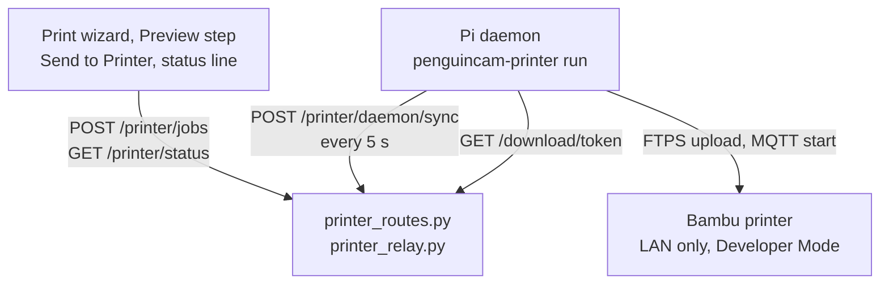

# Printer Setup

**Sending prints from PenguinCAM straight to a Bambu Lab printer in your shop.**

This guide is for the mentor who sets it up. It takes one evening, once. After that
students press a button.

---

## 1. What this gives you, and what it costs

You get a **Send to Printer** button on the Preview step of the print wizard, and a live
status line under the slice summary that shows what the printer is doing.

It costs you Bambu Cloud for that printer. The printer must run in **LAN-only mode with
Developer Mode turned on**:

- Bambu firmware released since 2025 rejects print starts from third-party software in any
  other mode.
- Developer Mode disconnects the printer from Bambu Cloud. The **Bambu Handy app stops
  working for that printer**, and **cloud sending from Bambu Studio stops working** too.
  Bambu Studio still sends over the LAN.

Decide that first, with the team. Everything below assumes the answer is yes.

Nothing else changes. No inbound ports are opened on the school network, and the printer's
access code never leaves the shop.

---

## 2. What you need

A Raspberry Pi on the same network as the printer, with outbound internet access. It sits
in the shop and relays jobs. Nothing on your network has to be reachable from outside.

- **Recommended:** Pi 4 with 2 GB of RAM or more. A Pi 5, Pi 400 or CM4 is fine too.
- **Minimum:** Pi 3B+ with 1 GB.
- **Not recommended:** Pi Zero 2 W. It has 512 MB and Wi-Fi only. A dropped association in
  the middle of a large upload burns the fifteen-minute deadline the relay allows a job.
- **64-bit Raspberry Pi OS Bookworm or newer is required.** One dependency publishes no
  32-bit wheel, so a 32-bit image would try to build it from source and fail after a long
  wait. The installer requires 64-bit (arm64) Raspberry Pi OS and stops otherwise.

Everything installs from prebuilt wheels. That is about 7 MB of downloads and takes a few
minutes on a Pi 4.

You also need the printer, on the same network, and access to the team's
`PenguinCAM-config.yaml` in Onshape.

---

## 3. Put the printer in LAN-only mode with Developer Mode

On the printer's own screen:

1. Open **Settings**, then the network or LAN section.
2. Turn on **LAN Only Mode**.
3. Turn on **Developer Mode** (LAN Mode Liveview on some firmware versions).
4. Write down the **LAN access code** the screen shows. It is eight digits. You need it in
   step 5.
5. Write down the printer's **IP address** while you are there. School networks often block
   the discovery broadcast, so you will probably type this in by hand.

---

## 4. Install on the Pi

Log in to the Pi and run one command:

```
curl -fsSL https://raw.githubusercontent.com/6238/PenguinCAM/<sha>/printer_daemon/install.sh | sudo bash
```

Replace `<sha>` with the commit you want to install. The current one is the tip of the
repository's default branch: open https://github.com/6238/PenguinCAM on `main` and copy the
commit hash. Pinning a commit means an install today and an install next month give you the
same daemon.

The `-f` in `curl -fsSL` matters. It makes a blocked or redirected URL fail cleanly instead
of piping an HTML error page into `bash`.

The installer creates a `penguincam` system user, installs the daemon under
`/opt/penguincam-printer`, writes a `penguincam-printer` command and a systemd service, and
then runs pairing.

**Re-running the same command upgrades the daemon in place.** It keeps your pairing code, so
the team's YAML needs no edit after an upgrade.

---

## 5. Pairing

The installer finishes by running `penguincam-printer pair`. You can also run it again at
any time with `sudo penguincam-printer pair`.

1. It listens for printers announcing themselves on the network for five seconds.
   **On most school networks that broadcast is blocked, so it hears nothing and asks for an
   IP address. That is the normal path, not a failure.** Type the printer's IP address, and
   its serial number when asked.
2. It asks for the **LAN access code** from step 3.
3. It connects to the printer and prints back the model and name the printer reports. If the
   printer does not answer, pairing stops and points you back at LAN-only mode, Developer
   Mode, and the access code. Nothing is saved.
4. It prints a **pairing code** such as `7K3M-Q9XW`, and the two YAML lines to paste.
5. It starts the service. From now on the Pi asks the backend for its token every thirty
   seconds until the code appears in your team's config.

The pairing code is the only thing that connects PenguinCAM to your printer. The access
code and the IP address stay on the Pi, in a file only the `penguincam` user can read.

---

## 6. Paste the code into the team's YAML

Add these two lines to `PenguinCAM-config.yaml` in Onshape:

```yaml
printing:
  pairing_code: "7K3M-Q9XW"
```

Use the code your Pi printed, not the one above.

Then **open PenguinCAM from Onshape and click the config refresh link in the header**, so
the new YAML loads now rather than at the next ten-minute refresh.

**Loading the YAML is what tells PenguinCAM the code exists. There is no button to press in
the wizard.** Within a minute of the refresh the Pi has its token and starts reporting, and
the status line on Preview comes alive.

---

## 7. What the status line means

The wizard shows the first row whose condition holds.

| Text | Condition |
|------|-----------|
| No printer paired | The YAML has no `printing.pairing_code`. |
| Pi with code 7K3M-Q9XW has not reported since the service started | The relay has not heard from a daemon with this code since it started. Links to the setup guide. |
| No printer reporting | A daemon has been heard, but no status snapshot is held. |
| Printer offline, last seen 7 min ago | The latest snapshot is older than two minutes. |
| Sending to printer | A job is pending and not yet handed to the daemon. |
| Printer starting sample_part | A job has been handed to the daemon and not yet acknowledged. |
| Printing sample_part, 42 percent, 31 min left | Snapshot state `running`. |
| Paused, sample_part | Snapshot state `paused`. |
| Upload to printer failed: connection refused | The last job failed within the last ten minutes. The daemon's one-line reason. |
| Printer unreachable from the Pi | Snapshot state `unreachable`. |
| Printer error: HMS_0300_0100_0001_0004 | Snapshot state `error`, with the printer's code. |
| Finished sample_part | Snapshot state `finished`. |
| Printer idle | Snapshot state `idle`. |

Every age shown, such as "last seen 7 min ago", is measured on the server from when the
snapshot arrived. The Pi's clock and the printer's clock are never used.

---

## 8. Changing or retiring a Pi

- **Swapped the printer, or reinstalled the Pi?** Run `sudo penguincam-printer pair` again.
  It keeps the existing pairing code, so the YAML needs no edit.
- **A former student still knows the code?** Run `sudo penguincam-printer pair --new-code`.
  It mints a fresh code. Replace the line in the YAML with the new one.
- **Retiring the Pi?** Delete the `printing` block from the YAML. No new session will ever
  send a job to that code again.

---

## 9. Troubleshooting

**Start here, on the Pi:**

```
sudo penguincam-printer status
```

It prints the config file's non-secret fields, whether the printer answers, whether a token
is set, and the result of one read-only request to the backend. It never posts a status
snapshot, so it cannot disturb the running service.

**"Pi with code 7K3M-Q9XW has not reported since the service started"**

The backend has never heard from this Pi. Either the code is not in the team's YAML, or the
YAML has not been refreshed since you added it. Open PenguinCAM from Onshape and click the
config refresh link in the header, then wait a minute. If it still says this, check that the
code in the YAML matches the one `status` prints on the Pi.

A redeploy of the site does not cause this, as long as `FLASK_SECRET_KEY` is set on the
server. The Pi's token survives, and its next sync recreates the record within seconds with
nobody opening anything. If every printer does show this after every deploy, the server is
missing `FLASK_SECRET_KEY`. Tell the owner, and point at
[DEPLOYMENT_GUIDE.md](DEPLOYMENT_GUIDE.md).

**The printer does not answer**

`status` says the printer is unreachable, or pairing refuses to continue. In order:

1. Is the printer still in **LAN-only mode** with **Developer Mode** on? A firmware update
   can turn Developer Mode off.
2. Is the **access code** still the one on the printer's screen? It changes when the printer
   is reset, and on some firmware versions when LAN mode is toggled.
3. Is the **IP address** still right? Give the printer a DHCP reservation so it stops
   moving.
4. Can the Pi reach it at all? `ping <printer ip>` from the Pi.

**A second Pi never pairs**

Two Pis with the same config file cannot both run. The backend refuses the second one while
the first is alive, by design, and the second sits at "waiting for the pairing code". This
is almost always a cloned SD card or a copied `config.toml`. Run
`sudo penguincam-printer pair --new-code` on the Pi you want to keep, or retire the old one.

**"blocked by a bot challenge"**

The Pi reached the site and got a Cloudflare challenge page instead of an answer. The Pi
cannot fix this. Tell the owner. The fix is a toggle in the Cloudflare dashboard, described
in [DEPLOYMENT_GUIDE.md](DEPLOYMENT_GUIDE.md).

**The print starts but uses the wrong filament**

Printing from an AMS is not supported yet. The daemon starts every print with the AMS off
and the external spool selected. Supporting an AMS is a one-line change in
`printer_daemon/printer.py`, in `PrinterLink.start`. Ask before making it, because the
right mapping depends on how the shop loads its filament.

**Where the logs are**

```
journalctl -u penguincam-printer -f
```

Full tracebacks go there and nowhere else. The status line only ever shows one line of
reason.

---

## 10. For developers

### The pieces



**The relay** is `printer_relay.py`. One record per normalised pairing code, held in memory
only. Nothing is written to disk and nothing goes in a database. A record is created when a
session presents the code or a valid token names it, and dropped when the process exits or
when nothing has touched it for twenty-four hours. The daemon's credential is a token signed
with `FLASK_SECRET_KEY`, so the relay recognises a daemon by signature and needs no storage.

**The daemon** is `printer_daemon/`. It is not a pip package and there is no
`pyproject.toml` anywhere in this project, so it is run as a module,
`python -m printer_daemon`, behind the `penguincam-printer` wrapper the installer writes. Its own
`requirements.txt` (`bambulabs_api`, `requests`, `tomli-w`) is installed on the Pi and into
the development venv by `make test-daemon`. None of it belongs in the repository's
`requirements.txt` or in the Docker image.

**The routes** are in `printer_routes.py`:

| Route | Who calls it |
|-------|--------------|
| `GET /printer/status` | The wizard, every five seconds on Preview. Needs an Onshape session. |
| `POST /printer/jobs` | The wizard, on Send to Printer. Needs an Onshape session. |
| `POST /printer/daemon/pair` | The Pi, to exchange its pairing code for a token. |
| `POST /printer/daemon/sync` | The Pi, every five seconds. Posts a snapshot, may receive a job. |
| `POST /printer/daemon/jobs/<id>/ack` | The Pi, when a job succeeds or fails. |
| `GET /printer/daemon/ping` | `penguincam-printer status`. Read-only. |
| `GET /install-printer.sh` | A convenience alias for the installer script. |

The daemon routes carry `Authorization: Bearer <token>`, except the pairing exchange, which
presents the pairing code itself, and the installer, which is public. All of them answer 403
to any request that did not arrive over HTTPS, unless the server is in development mode.

### Running a daemon against a local server

Start the backend as this project's [CLAUDE.md](../CLAUDE.md) describes, then on the Pi:

```
sudo penguincam-printer pair --backend http://<your mac's LAN address>:6238 --dev
```

`--dev` writes `dev = true` into the Pi's config file and is the only thing that lets the
daemon talk plain HTTP. Without it both `pair` and `run` refuse a non-HTTPS backend URL, so
a shop install can never end up talking HTTP. The installer never passes it. With it, `run`
logs a warning naming the URL at every start, so the shortcut cannot go unnoticed. The flag
exists because the development server is reached from the Pi by the Mac's LAN address, not
by `localhost`, so a hostname rule would not do the job.

To pair against a server nobody has opened in Onshape, set `PRINTER_DEV_PAIRING_CODE` to the
Pi's code before starting the backend. It seeds a relay record. It is read only in
development mode and ignored on Railway. See [DEPLOYMENT_GUIDE.md](DEPLOYMENT_GUIDE.md).

The daemon does not have to be on a Pi. The full recipe for running it on a Mac against a
backend in the agent container, and sending a real print through it, is
[PRINTER_DEV_TESTING.md](PRINTER_DEV_TESTING.md).

### The wizard panel, after the rebase

`static/printer_panel.js` is the printer half of the print wizard's Preview step. It ships
standalone, because the wizard itself belongs to `feature/3d-print-stage1`, so nothing loads
it yet. Five edits wire it in once both branches are on `main`. The same list is in the
file's own header comment, which is the copy to trust if the two ever drift.

1. `templates/print_wizard.html`: load the script, after `print_wizard.js`.
2. `static/print_wizard.js`: expose the slice's download token as
   `window.PenguinCAM.getDownloadToken`. Until this lands the status line renders and the
   Send to Printer item does not, because there would be nothing to send.
3. `static/print_wizard.js`: accept `printer` as a remembered and primary action, and let
   `performAction('printer')` call `window.PenguinCAMPrinterPanel.send()`.
4. Check every selector the script uses against the real `print_wizard.html`:
   `#preview-stats`, `#preview-errors`, `#do-menu` and `#do-menu li[data-action]`,
   `#stepbar li.active[data-step]`, and `section.step[data-step="preview"]`. The last two
   were never confirmed against the wizard. A selector that misses is logged once by name
   and the panel carries on without it, so a wrong guess shows up in the browser console
   rather than as a step that does nothing.
5. Add CSS for `.printer-status` and `.printer-error` to the stylesheet
   `print_wizard.html` loads. Without it the status line and a refused send's reason still
   read, they just do not look like the rest of the step.

Then open the wizard in the Onshape panel on port 6238 and watch the status line once by
hand. Until that happens the panel is the one part of this feature whose contract with the
page it lives on is unverified.

### Tests

```
make test-daemon   # the daemon's own suite; make test runs it too
```

The printer and the network are mocked throughout. `printer_daemon/tests/smoke_test.py` is
the one that talks to real hardware, and it is not part of `make test`.

### When you change the daemon

`printer_daemon/install.sh` pins `PENGUINCAM_SHA`. That SHA is the one place the daemon's
version is written. **Every pull request that changes anything under `printer_daemon/`
updates it to that pull request's merge commit.** Until a pull request is opened it reads
`REPLACE_BEFORE_MERGE`, and the installer refuses to run.

A short pointer to this guide will be added to [3D_PRINTING.md](3D_PRINTING.md) once
`feature/3d-print-stage1` merges.
